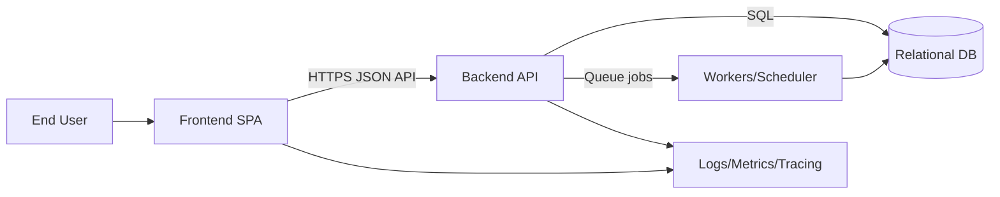

# Sport Scheduler Platform Architecture Handoff

## 1) Purpose and Scope

This handoff defines:
- Production-ready target architecture for a scheduling platform (clubs, players, matches, courts, availability, conflicts) across backend and frontend repository boundaries.
- Stable integration contract between repositories.
- Data model and storage strategy with timezone correctness.
- Business rules for scheduling and conflict resolution.
- Operational constraints for this server, including safe-update process and multi-project Docker usage.
- System requirements and limits:
  - Server-general limits (for any project on this host class).
  - Current sport-scheduler-specific limits (given current host state and co-located containers).
- Recommendations for an ideal system design (for future environment migration).

## 2) Current Environment Observations (Evidence)

### Host and runtime snapshot
- OS: Linux.
- RAM: 3.7 GiB total, about 1.9 GiB available at sample time.
- Swap: two active swapfiles (2 GiB + 2 GiB), total 4 GiB.
- Root disk: 38 GiB total, 34 GiB used, 2.5 GiB available (94% used).
- Docker storage:
  - Images: 11.93 GiB.
  - Build cache: 3.357 GiB reclaimable.
- Host ports in use:
  - 80/443 exposed by sport-scheduler web container.
  - SSH on 22/22222.

### Active containers and shared infrastructure
- sport-scheduler stack:
  - sports-scheduler-be-api-1
  - sports-scheduler-be-web-1
- Portfolio chatbot stack:
  - portfoliochat-api
  - portfoliochat-frontend
  - portfoliochat-db
- Shared Docker network: external network named web.
- Shared reverse-proxy concern: sport-scheduler web Caddy currently routes both sport-scheduler domain and portfoliochat domain traffic.

### Deployment process constraints
The enforced safe update flow requires:
- Swap active and at least 1 GiB available RAM before updates.
- No force pull; use git pull --ff-only.
- Build one service at a time.
- Recreate api and web only for website updates.
- Do not run destructive Docker cleanup commands (no docker compose down -v, no docker system prune) as a troubleshooting shortcut.

Operational implication:
- Deployment safety depends on sequencing, low memory pressure, and preserving Docker layer/cache behavior.

## 3) System Context and Component Boundaries

### Repositories and ownership
- Backend repository: sports-scheduler-be
  - Owns business rules, scheduling decisions, authorization, persistence, conflict detection, audit, and API contract.
- Frontend repository: sports-scheduler-web
  - Owns user workflows, forms, calendars/timelines, timezone display conversion, and API consumption.

### Context diagram (logical)



### Boundary rules
- Frontend never writes directly to database.
- Backend is single source of truth for all scheduling decisions.
- All cross-repo communication must use versioned HTTP contract.
- Contract changes must be backward-compatible within a major version.

## 4) API Contract Summary (Target)

Base path:
- /v2

Auth model:
- Short-lived access token (JWT) + refresh token rotation.
- Role and scope claims enforced in backend.

### Envelope standards
Success:

```json
{
  "data": {},
  "meta": {
    "requestId": "uuid",
    "pagination": { "cursor": "...", "nextCursor": "...", "limit": 50 }
  }
}
```

Error:

```json
{
  "error": {
    "code": "SCHEDULING_CONFLICT",
    "message": "Requested slot overlaps an existing booking",
    "details": {
      "conflicts": [{ "bookingId": "..." }]
    },
    "requestId": "uuid"
  }
}
```

Validation:
- Backend validates all query/body/params with schema validation.
- Unprocessable inputs return 400 with machine-readable details.

Pagination/filtering:
- Cursor pagination for high-volume lists (bookings, matches, audit).
- Standard query keys:
  - limit (max bounded)
  - cursor
  - sort
  - direction
  - filters as repeated keys or structured query object.

### Required endpoint groups
- Auth and identity:
  - POST /v2/auth/login
  - POST /v2/auth/refresh
  - POST /v2/auth/logout
  - GET /v2/me
- Clubs/facilities/courts:
  - CRUD /v2/clubs
  - CRUD /v2/facilities
  - CRUD /v2/courts
- Availability:
  - CRUD /v2/availability/templates
  - CRUD /v2/availability/overrides
- Matches and bookings:
  - CRUD /v2/matches
  - CRUD /v2/bookings
  - POST /v2/bookings/quote (dry-run conflict check)
  - POST /v2/bookings/{id}/reschedule
  - POST /v2/bookings/{id}/cancel
- Scheduling engine:
  - POST /v2/scheduling/suggestions
  - POST /v2/scheduling/validate
- Audit and admin:
  - GET /v2/audit
  - GET /v2/health
  - GET /v2/readiness

### Contract notes from current state
Current deployed API is football discovery-focused (/v1/football/*, /v1/analytics/events) and not yet scheduling-domain complete.

Known contract drift risk:
- Frontend analytics helper posts to /analytics/searchEvent, while backend route exposes /v1/analytics/events (after proxy rewrite rules).
- This mismatch is currently masked because analytics client ignores failures.

## 5) Data Model and Schema (Target)

Relational-first design (PostgreSQL recommended).

### Core entities
- users
- roles
- user_roles
- clubs
- club_memberships
- facilities
- courts
- operating_hours
- closure_windows
- availability_templates
- availability_exceptions
- matches
- match_participants
- bookings
- booking_attendees
- recurrence_rules
- recurrence_instances
- reschedule_requests
- conflict_events
- audit_log

### Key relationships
- A club has many facilities.
- A facility has many courts.
- A match optionally links to one booking (or generated from one booking).
- Availability can come from template + exceptions.
- Recurrence rule produces instances; each instance can be booked/cancelled/rescheduled independently.

### Soft delete and audit strategy
- Soft delete columns on mutable business entities:
  - deleted_at (UTC)
  - deleted_by
- Immutable audit table for all state transitions:
  - actor_id, action, entity_type, entity_id, before_json, after_json, created_at_utc.

### Index and integrity strategy
- Unique natural/business keys where applicable.
- Composite indexes for query-critical paths:
  - bookings(court_id, start_at_utc)
  - bookings(facility_id, start_at_utc)
  - matches(club_id, start_at_utc)
  - availability templates by (court_id, weekday).
- Foreign keys with explicit ON DELETE behavior.
- Check constraints for time ranges:
  - start_at_utc < end_at_utc
  - buffer_before_min >= 0
  - buffer_after_min >= 0

## 6) Concurrency and Overlap Control

### Transaction boundaries
- Booking create/reschedule/cancel each runs in a single DB transaction.
- Conflict validation and write happen in same transaction to avoid race.

### Locking approach
Preferred (PostgreSQL):
- Use exclusion constraint on tstzrange for each court to prevent overlaps at DB level.
- Use SELECT ... FOR UPDATE for rows representing candidate court/day where needed.

Example policy concept:
- No two active bookings on same court may overlap considering buffers:
  - effective_start = start_at_utc - buffer_before
  - effective_end = end_at_utc + buffer_after

### Idempotency
- Mutating endpoints accept Idempotency-Key header.
- Replay-safe handling for retries and flaky client networks.

## 7) Timezone Policy

### Canonical storage
- Store all instants in UTC (timestamptz).
- Store timezone identifier (IANA) for club/facility/user preferences.

### Input policy
- Client sends local datetime + timezone id, or UTC instant + timezone context.
- Backend validates timezone id against IANA database.

### DST and recurrence
- Recurrence rules interpreted in local zone of owning resource (usually facility zone).
- On DST transition:
  - Nonexistent local times are rejected with actionable error.
  - Ambiguous local times require explicit offset choice from client.

### Display policy
- Frontend displays in user-selected timezone by default.
- For facility-driven operations, also show facility local time to reduce operator mistakes.

## 8) Scheduling Business Rules (Target)

### Core rules
- Conflict detection:
  - Hard block on overlapping active bookings on same court.
- Capacity and eligibility:
  - Max participants per court/type enforced.
  - Role-based permissions (admin, manager, player).
- Duration and buffers:
  - Duration must be within configured min/max per sport/match type.
  - Buffers before/after are part of conflict window.
- Availability windows:
  - Booking must fit operating hours and not intersect closures.
- Recurrence:
  - Rule validation on create.
  - Future instances can be skipped by exception records.

### Priority and reschedule
- Priority hierarchy example:
  1) League/official matches
  2) Club tournaments
  3) Training sessions
  4) Casual bookings
- Reschedule logic:
  - Higher priority incoming booking may trigger conflict workflow (not silent overwrite).
  - Automatic move only when deterministic policy and user consent rules are satisfied.

### Cancellations and edge cases
- Support partial-day operations (custom hours per date).
- Late cancellation windows configurable.
- Re-open slots immediately after cancellation unless hold period configured.

## 9) Operational Concerns and Risks

### Current high risks
- Disk pressure is critical (about 2.5 GiB free on root, 94% used).
- Multi-project co-location means one project build can impact another project runtime.
- Shared external network and reverse-proxy host responsibilities are coupled.
- Safe-update process is manual and sequencing-dependent.
- Current web repo contains local uncommitted changes; pull/update flow may require operator attention.

### Existing deployment constraints
- Only api and web should be restarted for site updates.
- scraper and web-jobs are not part of standard web update path.
- Build cache should be preserved for low-risk updates.

### Observability gaps to close
- Add structured log correlation IDs across frontend and backend.
- Add readiness checks (dependency-aware) separate from liveness.
- Define SLOs and alerting thresholds.

## 10) System Requirements and Limits

## 10.1 General limits for this server class (as if newly used)

Assumed host class: roughly 4 GiB RAM, ~38 GiB root disk, Docker-based deployments.

### Hard strict limits (must not violate)
- Memory gate before deployment:
  - At least 1 GiB available RAM before image build/recreate.
  - At least one active 2 GiB swapfile (or equivalent swap capacity).
- Disk gate before deployment:
  - Minimum 3 GiB free on root before any build.
- Port ownership:
  - Only one reverse-proxy stack may bind host ports 80/443.
- Safety commands:
  - No destructive data-clearing commands as routine fix (no docker compose down -v, no docker system prune in normal operations).
- Deployment order:
  - Build services one at a time on low-memory hosts.

### Recommended limits (target operating envelope)
- Keep steady-state RAM usage < 70% host memory.
- Keep free root disk >= 20% (or >= 8 GiB, whichever is greater).
- Keep Docker image+cache footprint <= 60% of free disk budget.
- Enforce per-container memory limits/reservations in compose.
- Keep CPU throttling low enough that p95 API latency stays within SLO.

## 10.2 Sport Scheduler limits in current server state

### Hard strict limits (current state)
- Root disk is critically low (2.5 GiB free): do not start large parallel builds.
- Keep safe-update gate strict:
  - Stop update if available RAM < 1 GiB.
  - Stop if git pull --ff-only cannot fast-forward.
- For website deploys, only recreate:
  - api
  - web
- Do not include scraper/web-jobs in routine web deployment.
- Preserve web repo local ops fixes before pull/rebase.

### Recommended limits (current state)
- Schedule updates during low traffic and low co-project load windows.
- Keep only one active build process on host.
- Introduce image lifecycle policy (retain N recent images per project).
- Move bulky static assets/logos out of frontend repository over time (CDN or object storage).
- Add explicit resource limits in compose for both projects.

## 11) Implementation Assumptions

### Backend assumptions
- Move scheduling domain to relational DB (PostgreSQL preferred) for integrity and overlap constraints.
- Keep football discovery API as separate bounded context if still needed.
- Introduce migration tooling, idempotent seeds, and schema versioning.

### Frontend assumptions
- Frontend consumes versioned contract only (no hidden route aliases).
- Frontend handles timezone conversion from UTC + zone metadata.
- Calendar UX must support conflict previews and deterministic error rendering.

### Cross-repo assumptions
- Contract source of truth via OpenAPI spec in backend CI artifacts.
- Frontend CI validates generated client/types against backend spec.
- Breaking changes require coordinated version bump and migration notes.

## 12) Optimal Ideal System Design (Recommended Future State)

For best reliability and team velocity, target this design:
- Environment split:
  - Separate dev/staging/prod.
  - Avoid co-locating unrelated production apps on a single small host.
- Managed data tier:
  - Managed PostgreSQL with PITR backups.
  - Optional Redis for locks, rate limits, and queue support.
- Stateless app tier:
  - API replicas behind managed ingress/reverse proxy.
  - Dedicated worker deployment for recurring generation and heavy scheduling jobs.
- Storage strategy:
  - Object storage + CDN for static assets/logos.
  - Keep Git repos source-only, not large binary stores.
- Observability:
  - Central logs, metrics, tracing.
  - Alerting on RAM, disk, error rate, and latency SLO burn.
- Deployment:
  - Blue/green or rolling deploys with readiness gates.
  - Automated rollback on health regression.
- Security baseline:
  - Secrets manager, least-privilege DB users, audit trails, token rotation.

## 13) Suggested Migration Sequence

1. Freeze and document current v1 contract and proxy rewrites.
2. Define OpenAPI for v2 scheduling domain.
3. Implement relational schema and conflict-safe booking transactions.
4. Build timezone-safe recurrence engine and validation APIs.
5. Add auth/role model and audit logging.
6. Migrate frontend flows to v2 endpoints incrementally.
7. Move static assets to object storage/CDN.
8. Move production workloads to larger or separated infrastructure.
